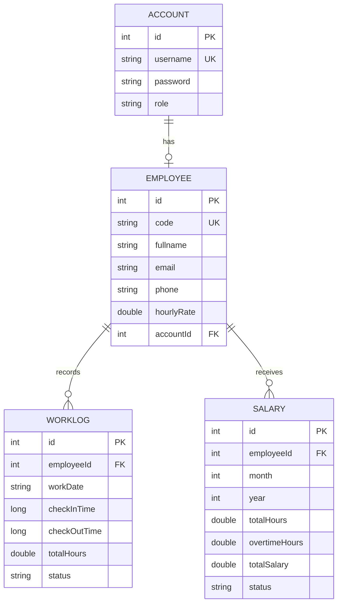
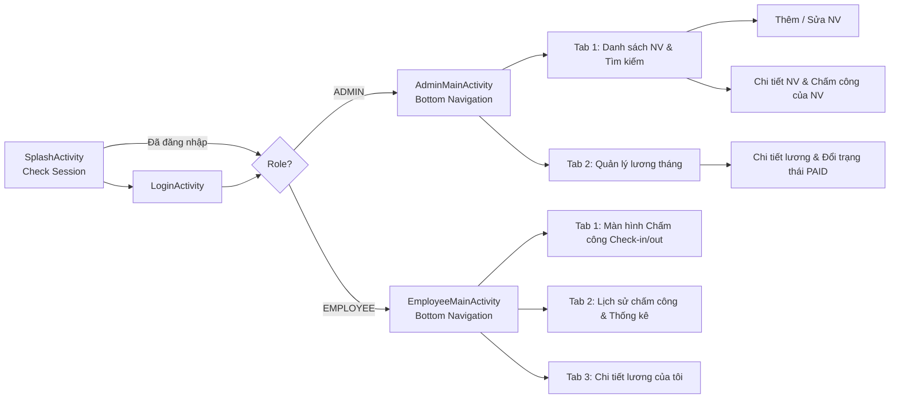

# Kế hoạch dự án: Quản lý giờ làm & lương nhân viên (Android)

> Kotlin · XML Views + ViewBinding · Room (SQLite) · MVVM · GitHub · Sprint 6 ngày · Nhóm 3 người

---

## 1. Các quyết định kỹ thuật & Nghiệp vụ

| Hạng mục | Lựa chọn |
|---|---|
| **Ngôn ngữ / IDE** | Kotlin 2.x · Android Studio (Koala / Ladybug trở lên) |
| **Giao diện (UI)** | XML Layout + ViewBinding + Material Components 3 |
| **CSDL (Database)** | Room (SQLite) + KSP (Kotlin Symbol Processing) |
| **Kiến trúc** | MVVM: `Activity/Fragment → ViewModel → Repository → DAO` |
| **Bất đồng bộ** | Kotlin Coroutines + `Flow` / `LiveData` |
| **Phiên đăng nhập** | SharedPreferences (`SessionManager`) |
| **Tài khoản** | Seed sẵn Admin `admin / admin123`; Admin thêm Employee → tự động tạo Account role `EMPLOYEE` |
| **Tính Overtime (OT)** | Tính **theo ngày**: phần vượt **8h/ngày** là OT, hệ số **1.5 × hourlyRate** |
| **Quản lý source code** | GitHub, Git Flow rút gọn (`main` / `develop` / `feature/*`) |
| **Bàn giao** | Source code + repo GitHub + file APK release |

Cấu hình SDK: `minSdk 24`, `targetSdk/compileSdk 35`, JDK 17.

---

## 2. Thiết kế CSDL (Room Database)



### Chi tiết các bảng & ràng buộc

1. **`Account`**:
   - `id`: Int (Primary Key, autogenerate = true)
   - `username`: String (UNIQUE index)
   - `password`: String (lưu mã hash SHA-256)
   - `role`: String (`ADMIN` hoặc `EMPLOYEE`)

2. **`Employee`**:
   - `id`: Int (Primary Key, autogenerate = true)
   - `code`: String (UNIQUE index, mã nhân viên ví dụ: `NV001`)
   - `fullname`: String
   - `email`: String
   - `phone`: String
   - `hourlyRate`: Double (mức lương theo giờ, ví dụ: 50.000đ/h)
   - `accountId`: Int (Foreign Key tham chiếu `Account.id`, onDelete = CASCADE)

3. **`WorkLog`**:
   - `id`: Int (Primary Key, autogenerate = true)
   - `employeeId`: Int (Foreign Key tham chiếu `Employee.id`, onDelete = CASCADE)
   - `workDate`: String (định dạng `"yyyy-MM-dd"`)
   - **Composite Index Unique**: `(employeeId, workDate)` (chặn check-in nhiều lần trong cùng 1 ngày ngay ở tầng CSDL)
   - `checkInTime`: Long (timestamp epoch millis)
   - `checkOutTime`: Long? (nullable, timestamp epoch millis khi checkout)
   - `totalHours`: Double (số giờ làm trong ngày)
   - `status`: String (`IN_PROGRESS`, `COMPLETED`, `INCOMPLETE`)

4. **`Salary`**:
   - `id`: Int (Primary Key, autogenerate = true)
   - `employeeId`: Int (Foreign Key tham chiếu `Employee.id`, onDelete = CASCADE)
   - `month`: Int (1 - 12)
   - `year`: Int
   - **Composite Index Unique**: `(employeeId, month, year)` (mỗi tháng chỉ có 1 bản ghi lương cho 1 nhân viên)
   - `totalHours`: Double (tổng giờ làm trong tháng)
   - `overtimeHours`: Double (tổng giờ làm thêm OT trong tháng)
   - `totalSalary`: Double (tổng lương thực nhận)
   - `status`: String (`PENDING`, `PAID`)

**Seed data sẵn trong DB (Callback `onCreate`)**:
- 1 Admin mặc định: `username: admin`, `password: admin123`, `role: ADMIN`
- 3 Nhân viên mẫu với đầy đủ thông tin & tài khoản tương ứng
- Khoảng 15-20 bản ghi `WorkLog` mẫu trong tháng hiện tại để sẵn sàng demo lương ngay khi chấm điểm.

---

## 3. Quy tắc nghiệp vụ (Business Rules)

### 3.1 Tính giờ làm việc & OT (khi Check-out)
```
totalHours   = round2((checkOutTime - checkInTime) / 3_600_000.0)
regularHours = min(totalHours, 8.0)
otHours      = max(totalHours - 8.0, 0.0)
```

### 3.2 Tính lương tháng
```
Salary.totalHours    = Σ totalHours   (chỉ tính các WorkLog COMPLETED trong tháng)
Salary.overtimeHours = Σ otHours
Salary.totalSalary   = (totalHours - overtimeHours) × hourlyRate + overtimeHours × hourlyRate × 1.5
```
- **Tự động cập nhật**: Mỗi khi nhân viên check-out thành công → gọi hàm `upsertMonthlySalary()` cập nhật bảng `Salary` tháng đó (status `PENDING`).
- **Admin tính lại**: Admin có nút **"Tính lại lương tháng"** cho toàn bộ nhân viên (sử dụng khi admin cập nhật `hourlyRate`).
- **Khoá bản ghi**: Những bản ghi lương đã chuyển sang trạng thái `PAID` sẽ bị khoá, không được tính toán đè lên.

### 3.3 Data Validation
| Tình huống | Cách xử lý |
|---|---|
| Check-in lần 2 trong ngày | Kiểm tra trước trong Repository + Unique DB index → Hiển thị thông báo "Bạn đã check-in hôm nay" |
| Check-out khi chưa check-in | Vô hiệu hoá nút Check-out trên UI; Repository từ chối thao tác |
| Check-out lần 2 | Vô hiệu hoá nút; kiểm tra trạng thái log hôm nay nếu đã `COMPLETED` thì chặn |
| `checkOutTime <= checkInTime` | Kiểm tra thời gian hợp lệ, từ chối lưu và báo lỗi |
| Quên check-out hôm trước | Khi login/mở app ngày mới: tự động quét các log ngày cũ còn `IN_PROGRESS` chuyển thành `INCOMPLETE`, `totalHours = 0`, đánh dấu cảnh báo màu đỏ |
| Form thêm/sửa nhân viên | Kiểm tra rỗng, Regex Email chuẩn, SĐT 10 số, `hourlyRate > 0`, kiểm tra trùng mã `code` và `username` |
| Xoá nhân viên | Dialog cảnh báo xác nhận xóa. Xoá Employee sẽ CASCADE xoá Account, WorkLog, Salary liên quan |

### 3.4 Quản lý phiên đăng nhập (`SessionManager`)
- Lưu trong `SharedPreferences`: `accountId`, `username`, `role`, `employeeId`, `isLoggedIn`, `rememberMe`.
- Tự động điều hướng: Nếu đã tick "Ghi nhớ đăng nhập", khi mở app Splash sẽ tự động vào màn hình `AdminMainActivity` hoặc `EmployeeMainActivity`.
- Đăng xuất: Xoá thông tin session hiện tại và quay về màn `LoginActivity`.

---

## 4. Danh sách màn hình & Luồng điều hướng



---

## 5. Cấu trúc thư mục mã nguồn (Package Structure)

```
com.team.payroll
├── data/
│   ├── local/
│   │   ├── AppDatabase.kt
│   │   ├── Converters.kt
│   │   └── DatabaseSeeder.kt
│   ├── entity/
│   │   ├── Account.kt
│   │   ├── Employee.kt
│   │   ├── WorkLog.kt
│   │   └── Salary.kt
│   ├── dao/
│   │   ├── AccountDao.kt
│   │   ├── EmployeeDao.kt
│   │   ├── WorkLogDao.kt
│   │   └── SalaryDao.kt
│   └── repository/
│       ├── AuthRepository.kt
│       ├── EmployeeRepository.kt
│       ├── AttendanceRepository.kt
│       └── SalaryRepository.kt
├── domain/
│   ├── WorkHoursCalculator.kt
│   ├── SalaryCalculator.kt
│   ├── PayrollConfig.kt
│   └── Validators.kt
├── session/
│   └── SessionManager.kt
├── ui/
│   ├── auth/
│   │   ├── SplashActivity.kt
│   │   ├── LoginActivity.kt
│   │   └── LoginViewModel.kt
│   ├── admin/
│   │   ├── AdminMainActivity.kt
│   │   ├── employee/ (List, Form Add/Edit, Detail)
│   │   └── salary/ (SalaryManagementFragment, SalaryDetailDialog)
│   └── employee/
│       ├── EmployeeMainActivity.kt
│       ├── attendance/ (CheckInFragment, AttendanceViewModel)
│       ├── history/ (HistoryFragment, HistoryAdapter)
│       └── salary/ (MySalaryFragment)
└── util/
    ├── DateTimeUtils.kt
    ├── HashUtils.kt
    └── Result.kt
```

---

## 6. Phân chia công việc chi tiết cho 3 thành viên

> **Quy tắc phân chia**: Tách biệt rõ ràng theo từng phân hệ màn hình và package để tránh xung đột mã nguồn (merge conflict). 

### 👤 Thành viên 1 (Trưởng nhóm) – Nền tảng, Database Core, Auth & Tích hợp
*Trách nhiệm chính: Đặt nền móng dự án, kiến trúc dữ liệu và điều phối merge code.*

- **Task 1.1**: Khởi tạo project Android Studio, kết nối Git Repo, cấu hình `build.gradle.kts` (Room, KSP, Coroutines, Lifecycle, Material 3, ViewBinding).
- **Task 1.2 (Ưu tiên số 1 - Xong trước 12h Ngày 1)**: Xây dựng toàn bộ 4 Entity (`Account`, `Employee`, `WorkLog`, `Salary`), 4 DAO tương ứng, `AppDatabase`, `Converters` và `DatabaseSeeder`.
- **Task 1.3**: Xây dựng các tiện ích dùng chung: `DateTimeUtils`, `HashUtils` (SHA-256), `Result<T>`, `AppContainer` (Service Locator).
- **Task 1.4**: Cài đặt `SessionManager` với `SharedPreferences`.
- **Task 1.5**: Xây dựng `SplashActivity`, `LoginActivity`, `LoginViewModel`, `AuthRepository` (xác thực mật khẩu hash, phân quyền điều hướng, tính năng Ghi nhớ đăng nhập, Đăng xuất).
- **Task 1.6**: Dựng sẵn khung sườn `AdminMainActivity` và `EmployeeMainActivity` với Bottom Navigation (gắn sẵn các Fragment rỗng để TV2 và TV3 chỉ việc code vào).
- **Task 1.7**: Review Pull Request, giải quyết merge conflict, tổng hợp kiểm thử tích hợp, build file APK release hoàn chỉnh và viết `README.md`.

---

### 👤 Thành viên 2 – Phân hệ Quản trị viên (Admin): Quản lý Nhân viên & Bảng lương
*Trách nhiệm chính: Toàn bộ nghiệp vụ và màn hình thuộc quyền hạn của Admin.*

- **Task 2.1**: Xây dựng `EmployeeRepository` (Thêm NV kèm tạo Account trong 1 `@Transaction`, cập nhật NV, xóa NV, tìm kiếm theo tên/mã/email).
- **Task 2.2**: Xây dựng UI & ViewModel danh sách nhân viên: `RecyclerView`, tìm kiếm với `SearchView`, nút FAB chuyển sang màn hình thêm mới.
- **Task 2.3**: Xây dựng Form thêm/sửa nhân viên: validation họ tên, email, SĐT, lương giờ, kiểm tra không cho trùng `code` và `username`.
- **Task 2.4**: Màn hình xem chi tiết nhân viên + chức năng xóa nhân viên kèm dialog xác nhận an toàn.
- **Task 2.5**: Xây dựng `SalaryCalculator` (thuật toán tính lương theo giờ thường và giờ OT 1.5x) + viết Unit Test cho logic này.
- **Task 2.6**: Xây dựng `SalaryRepository`: Các hàm tính/cập nhật lương tháng (`upsertMonthlySalary`), tính lại lương toàn bộ nhân viên (`recalculateMonth`), chuyển trạng thái `markPaid()`.
- **Task 2.7**: Xây dựng màn hình Quản lý bảng lương Admin: chọn Tháng/Năm, xem danh sách lương từng nhân viên, tổng tiền lương toàn công ty, nút "Tính lại toàn bộ", nút đánh dấu "Đã thanh toán (PAID)".

---

### 👤 Thành viên 3 – Phân hệ Nhân viên (Employee): Chấm công, Lịch sử & Xem lương
*Trách nhiệm chính: Toàn bộ nghiệp vụ chấm công hàng ngày và tra cứu của nhân viên.*

- **Task 3.1**: Xây dựng `WorkHoursCalculator` (tính giờ làm từ check-in đến check-out, tách giờ thường và giờ OT > 8h) + viết Unit Test.
- **Task 3.2**: Xây dựng `AttendanceRepository`: `checkIn()`, `checkOut()`, kiểm tra log quên check-out ngày hôm trước (`markIncompleteLogs`).
- **Task 3.3**: Màn hình Chấm công (`CheckInFragment`): Đồng hồ thời gian thực, trạng thái làm việc hôm nay, nút Check-in / Check-out tự động đổi trạng thái và màu sắc. Toàn bộ validation chặn check-in 2 lần, chặn check-out sai giờ.
- **Task 3.4**: Liên kết luồng: Sau khi check-out thành công, gọi tự động cập nhật bảng lương tháng tương ứng (phối hợp cùng `SalaryRepository` của TV2).
- **Task 3.5**: Màn hình Lịch sử chấm công (`HistoryFragment`): Cho phép chọn lọc theo tháng, hiển thị danh sách từng ngày làm (badge màu theo `COMPLETED`, `INCOMPLETE`), card tổng hợp trên cùng (Tổng ngày làm, Tổng giờ, Tổng giờ OT).
- **Task 3.6**: Màn hình Xem lương cá nhân (`MySalaryFragment`): Chọn tháng tra cứu, hiển thị chi tiết số giờ chuẩn, số giờ OT, mức lương theo giờ, tổng lương nhận được và trạng thái thanh toán.

---

## 7. Lịch trình Sprint 6 ngày (Tối ưu điểm tốc độ)

```
[Ngày 1] Setup Base, Database Core (TV1) ──> Dựng Layouts (TV2, TV3)
[Ngày 2] Login, Auth (TV1) ───────────────> CRUD Nhân viên (TV2) ──> Check-in/out (TV3)
[Ngày 3] Khung Navigation & Session (TV1) ─> Màn Chi tiết & Xóa NV ─> Lịch sử chấm công
[Ngày 4] Ghép nối hệ thống ───────────────> Quản lý lương Admin ───> Màn Xem lương cá nhân
[Ngày 5] Testing tích hợp toàn bộ, xử lý Edge Cases & Data Validation
[Ngày 6] Freeze code, Build Release APK, nghiệm thu checklist & Bàn giao
```

| Ngày | TV1 (Lead / Core) | TV2 (Admin Feature) | TV3 (Employee Feature) | Mục tiêu nghiệm thu ngày |
|---|---|---|---|---|
| **D1** | **Sáng**: Setup Git repo + Gradle + Viết Entity/DAO/DB.<br>**Chiều**: `SessionManager` + Utils + Seeder data. | **Sáng**: Dựng layout XML danh sách & form NV.<br>**Chiều**: Xây dựng `EmployeeRepository`. | **Sáng**: Dựng layout XML chấm công & lịch sử.<br>**Chiều**: `WorkHoursCalculator` + Test. | ✅ Merge DB & Base contract vào `develop` lúc 12h. |
| **D2** | **Sáng**: Login UI + Hash + ViewModel.<br>**Chiều**: Phân quyền điều hướng + sườn 2 MainActivity. | **Sáng**: Adapter & Danh sách NV.<br>**Chiều**: Hoàn thiện Form Thêm/Sửa NV. | **Sáng**: `AttendanceRepository` + Check-in logic.<br>**Chiều**: Check-out logic + validation cơ bản. | ✅ Đăng nhập đúng role; CRUD NV và Check-in/out cơ bản chạy được. |
| **D3** | **Sáng**: Review PR, merge code đợt 1.<br>**Chiều**: Hoàn thiện Ghi nhớ đăng nhập + Logout. | **Sáng**: Tìm kiếm & Xóa NV có dialog.<br>**Chiều**: `SalaryCalculator` + Unit Test. | **Sáng**: Màn hình Lịch sử chấm công.<br>**Chiều**: Thống kê tổng giờ làm & xử lý INCOMPLETE. | ✅ **Demo nội bộ đợt 1**: Admin quản lý NV tốt, Nhân viên chấm công và xem lịch sử mượt mà. |
| **D4** | **Sáng**: Hỗ trợ kết nối data Chấm công ↔ Lương.<br>**Chiều**: Viết thêm Seeder data phong phú để test. | **Sáng**: `SalaryRepository` + Upsert lương.<br>**Chiều**: UI Quản lý lương của Admin + Nút tính lại. | **Sáng**: Kết nối Check-out tự update lương.<br>**Chiều**: UI Tra cứu lương của nhân viên. | ✅ **Demo nội bộ đợt 2**: Toàn bộ luồng tính toán lương tự động và thủ công chạy đúng. |
| **D5** | **Cả ngày**: Test tích hợp chéo, bắt lỗi edge cases theo checklist mục 9, tạo issue fix bug. | **Sáng**: Fix bug phân hệ Admin.<br>**Chiều**: Hoàn thiện UX (loading, empty state). | **Sáng**: Fix bug phân hệ Employee.<br>**Chiều**: Hoàn thiện UX (thông báo lỗi, màu sắc status). | ✅ **Code Freeze** lúc 17:00. Ổn định toàn bộ tính năng. |
| **D6** | **Sáng**: Merge `develop` vào `main`, đánh tag `v1.0`, xuất file APK Release, viết `README.md`. | **Sáng**: Test file APK trên máy thật. | **Sáng**: Test file APK trên máy thật. | 🚀 **Bàn giao / Nộp bài sớm để đạt điểm tối đa.** |

---

## 8. Quy tắc làm việc với Git & Hạn chế Conflict

1. **Nhánh chính**:
   - `main`: Chỉ chứa code đã ổn định tuyệt đối và có thể release APK.
   - `develop`: Nhánh tích hợp chung của cả nhóm.
   - `feature/<tên-thành-viên>-<tên-chức-năng>`: Nhánh làm việc riêng (Ví dụ: `feature/tv2-employee-crud`).
2. **Quy tắc giảm conflict**:
   - Mỗi thành viên làm việc trên các Activity/Fragment và Layout riêng biệt.
   - File tài nguyên chuỗi ký tự chia nhỏ: `strings_auth.xml`, `strings_admin.xml`, `strings_employee.xml`.
   - File cấu hình chung `build.gradle.kts` và `AppDatabase.kt` do **TV1** quản lý; nếu TV2/TV3 cần thêm thư viện thì báo TV1 cập nhật.
3. **Quy trình đẩy code**:
   - Trước khi tạo Pull Request: Phải `git checkout develop` -> `git pull` -> quay lại nhánh của mình và `git merge develop` để test local trước.
   - Tạo Pull Request vào `develop` và nhờ ít nhất 1 thành viên khác review.

---

## 9. Checklist kiểm thử nghiệm thu (Acceptance Criteria)

- [ ] **Đăng nhập & Phiên**:
  - [ ] Đăng nhập sai tài khoản/mật khẩu -> Báo lỗi rõ ràng.
  - [ ] Đăng nhập tài khoản Admin -> Vào đúng màn hình Admin.
  - [ ] Đăng nhập tài khoản Employee -> Vào đúng màn hình Employee.
  - [ ] Bật "Ghi nhớ đăng nhập" -> Tắt hẳn app bật lại vào thẳng màn hình chính, không cần nhập lại mật khẩu.
  - [ ] Bấm "Đăng xuất" -> Xoá phiên, trở về màn hình Login.
- [ ] **Quản lý Nhân viên**:
  - [ ] Thêm nhân viên với mã NV hoặc username đã tồn tại -> Báo lỗi trùng lặp.
  - [ ] Thêm nhân viên thành công -> Tự động đăng nhập được bằng tài khoản vừa tạo (role EMPLOYEE).
  - [ ] Cập nhật thông tin nhân viên (họ tên, email, sđt, lương giờ) -> Dữ liệu cập nhật đúng.
  - [ ] Xoá nhân viên -> Dữ liệu bảng công và lương liên quan cũng được xoá sạch (CASCADE).
  - [ ] Tìm kiếm nhân viên theo tên, mã NV hoạt động nhanh và chính xác.
- [ ] **Chấm công & Giờ làm**:
  - [ ] Chấm công lần 1 (Check-in) -> Lưu đúng ngày, giờ bắt đầu, trạng thái `IN_PROGRESS`.
  - [ ] Bấm Check-in lần 2 trong cùng ngày -> Ứng dụng từ chối và cảnh báo.
  - [ ] Chưa Check-in mà bấm Check-out -> Nút bị ẩn hoặc ứng dụng từ chối.
  - [ ] Bấm Check-out -> Tính đúng `totalHours` làm tròn 2 chữ số thập phân, trạng thái chuyển `COMPLETED`.
  - [ ] Làm trên 8 tiếng -> Hệ thống tính chính xác số giờ thường (8h) và số giờ Overtime (phần dư >8h).
  - [ ] Quên check-out ngày hôm trước -> Mở app ngày mới bản ghi cũ tự chuyển sang `INCOMPLETE` (0 giờ).
- [ ] **Lương & Bảng lương**:
  - [ ] Nhân viên Check-out xong -> Bảng lương tháng tự động cập nhật số giờ và số tiền tương ứng.
  - [ ] Công thức lương đúng tuyệt đối: `(Giờ chuẩn × Lương giờ) + (Giờ OT × Lương giờ × 1.5)`.
  - [ ] Admin bấm "Tính lại lương tháng" -> Cập nhật lại số tiền cho toàn bộ nhân viên chưa thanh toán (PENDING).
  - [ ] Admin đổi trạng thái sang "PAID" -> Bản ghi lương được khoá lại.
  - [ ] Nhân viên chỉ xem được bảng lương của chính mình, không xem được của người khác.
- [ ] **Kỹ thuật & Trải nghiệm**:
  - [ ] Xoay ngang/dọc màn hình không bị crash app, không mất dữ liệu đang hiển thị (sử dụng ViewModel).
  - [ ] Không đơ giật giao diện khi đọc ghi CSDL (toàn bộ chạy qua Coroutines).
